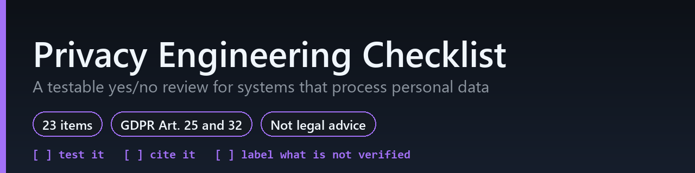

# Privacy Engineering Checklist

    

A testable yes/no checklist for engineers and reviewers who build systems that process personal data. Every item names a quick test and the source it rests on.

Use it as a design-review gate, a pull-request template, or a pre-launch review.

> Last verified: 2026-11-17. This is an engineering review aid, **not legal advice**. GDPR is the anchor because its clauses are short and testable. GDPR wording was checked against EUR-Lex. See [What was not verified](#what-was-not-verified) for what was not.

## Contents

- [1. Data minimization and defaults](#1-data-minimization-and-defaults) (5 items)
- [2. Retention and deletion](#2-retention-and-deletion) (4 items)
- [3. Data subject rights](#3-data-subject-rights) (4 items)
- [4. Risk assessment, records and processors](#4-risk-assessment-records-and-processors) (4 items)
- [5. Security of processing and breach handling](#5-security-of-processing-and-breach-handling) (5 items)
- [6. Privacy-enhancing technologies (PETs)](#6-privacy-enhancing-technologies-pets) (1 items)
- [Scoring](#scoring)
- [Verified references](#verified-references)
- [What was not verified](#what-was-not-verified)
- [Related checklists](#related-checklists)

## How to use it

Want only the tick boxes? Copy [CHECKLIST.md](CHECKLIST.md).

1. Copy the checklist into a design doc or launch ticket.
2. Tick an item only after you ran its test and kept the evidence (a ticket, a log line, a screenshot).
3. Sections 1 to 4 are blockers for launch. Sections 5 and 6 are hardening.

## 1. Data minimization and defaults

Basis: GDPR Art. 5(1)(c) (data adequate, relevant and limited to what is necessary) and Art. 25(2) (by default, only data necessary for each specific purpose is processed, covering amount collected, extent of processing, storage period and accessibility). EDPB Guidelines 4/2019 on Art. 25, version 2.0, adopted 20 October 2020.

- [ ] **1.1** Every collected field maps to a documented purpose. *Test:* diff the collected fields against the purpose register and list any field with no purpose. *Basis:* Art. 5(1)(c), Art. 25(2).
- [ ] **1.2** Defaults collect only what each purpose needs. *Test:* sign up or install with all defaults and diff the collected data against the purpose register. *Basis:* Art. 25(2).
- [ ] **1.3** Personal data is not made accessible to an indefinite number of people by default. *Test:* create a new account and confirm the profile and content are private. *Basis:* Art. 25(2).
- [ ] **1.4** Test and training environments contain no production personal data, or use a documented minimised subset. *Test:* sample a test database for real names, emails and identifiers. *Basis:* NIST SP 800-53 PM-25 (Minimization of PII Used in Testing, Training, and Research).
- [ ] **1.5** Processing purposes are documented and enforced in the system. *Test:* pick one purpose and show where code or policy blocks use for another purpose. *Basis:* NIST SP 800-53 PT-3 (Processing Purposes).

## 2. Retention and deletion

Basis: GDPR Art. 5(1)(e) (kept no longer than necessary), EDPB 4/2019 paragraph 82 (storage limitation elements include automated deletion, enforced and tested retention policies, and backup and log retention).

- [ ] **2.1** Every data category has a written retention period and an owner. *Test:* pick three categories and show the period and owner. *Basis:* Art. 5(1)(e).
- [ ] **2.2** An automated deletion job enforces each period. *Test:* show the job configuration and its last run log. *Basis:* EDPB 4/2019 para 82.
- [ ] **2.3** The deletion job is tested and the evidence is kept. *Test:* insert an expired record and confirm it is gone from the primary store, and that the backup and log rule is documented. *Basis:* EDPB 4/2019 para 82.
- [ ] **2.4** User sessions expire after a configured idle time. *Test:* leave a session idle past the limit and confirm re-authentication. *Basis:* OWASP Top 10 Privacy Risks v2.0, P8 Missing or Insufficient Session Expiration.

## 3. Data subject rights

Basis: GDPR Art. 12(3). Respond without undue delay and in any event within one month of receipt, extendable by two further months with notice of the extension inside the first month. "One month" is a calendar period, not 30 days. Rights are in Arts. 15 to 22.

- [ ] **3.1** A request workflow records the receipt date and computes a calendar-month due date. *Test:* submit a test request and check the due date. *Basis:* Art. 12(3).
- [ ] **3.2** An extension notice template exists and can be sent within the first month. *Test:* show the template and the workflow step. *Basis:* Art. 12(3).
- [ ] **3.3** Deletion requests reach every system that holds the data, including processors. *Test:* delete a test subject and search each system for the identifier. *Basis:* Art. 28(3)(e) (processor assists with data subject requests), Art. 17.
- [ ] **3.4** (US, California) Global Privacy Control signals are honoured as an opt-out request. *Test:* send a request with the GPC signal and confirm the opt-out is recorded. *Basis:* [California AG CCPA FAQ B.8](https://oag.ca.gov/privacy/ccpa). Deletion is answered within 45 days, extendable by 45 (FAQ D.3).

## 4. Risk assessment, records and processors

- [ ] **4.1** A DPIA is completed **before** launch for processing that meets an Art. 35(3) trigger, and it contains the four Art. 35(7) elements. *Test:* for the newest high-risk feature, show a DPIA dated before go-live. *Basis:* Art. 35.
- [ ] **4.2** A record of processing exists with the Art. 30(1) fields (purposes, categories, recipients, transfers, and retention and security descriptions where possible). *Test:* sample three activities and check each field. *Basis:* Art. 30(1).
- [ ] **4.3** Each processor has a written contract covering Art. 28(3)(a) to (h). *Test:* map each clause of each contract to (a) through (h) and mark gaps. *Basis:* Art. 28(3).
- [ ] **4.4** Design review uses a privacy threat model such as LINDDUN (Linking, Identifying, Non-repudiation, Detecting, Data Disclosure, Unawareness, Non-compliance). *Test:* show a completed model covering all seven categories for one system. *Basis:* [LINDDUN](https://www.linddun.org/threat-types/), EDPB 4/2019 para 85 (threat modelling).

## 5. Security of processing and breach handling

Basis: GDPR Art. 32(1) (pseudonymisation and encryption, ongoing confidentiality, integrity, availability and resilience, timely restoration, and regular testing of effectiveness), Arts. 33 and 34.

- [ ] **5.1** Personal data is encrypted in transit and at rest, or the reason it is not is documented. *Test:* inspect storage and transport settings. *Basis:* Art. 32(1)(a) names pseudonymisation and encryption as example measures.
- [ ] **5.2** Pseudonymised data is classified as personal data in the data inventory. *Test:* check the classification of one pseudonymised dataset. *Basis:* EDPB Guidelines 01/2025 on pseudonymisation para 22 (consultation version). Storing the re-identification key apart from the data is good practice, not a verified requirement of that paragraph.
- [ ] **5.3** A breach register exists and the runbook starts a 72-hour clock at awareness. *Test:* run a tabletop exercise and check the register entry and the notification timestamp. *Basis:* Art. 33(1) (not later than 72 hours after becoming aware) and Art. 33(5) (document every breach).
- [ ] **5.4** The runbook covers notifying data subjects without undue delay for likely high risk. *Test:* show the decision step and the template. *Basis:* Art. 34.
- [ ] **5.5** Security controls are tested on a schedule. *Test:* show the last test report and its date. *Basis:* Art. 32(1)(d).

## 6. Privacy-enhancing technologies (PETs)

- [ ] **6.1** For each PET you use or reject (for example differential privacy, secure multiparty computation, homomorphic encryption, federated learning), the decision is recorded with the reason. *Test:* show the decision log. *Basis:* good practice. The [ICO PETs guidance](https://ico.org.uk/for-organisations/uk-gdpr-guidance-and-resources/data-sharing/privacy-enhancing-technologies/) lists these techniques. This repo does not claim any PET makes data anonymous.

## Scoring

| Result | Meaning |
| --- | --- |
| All of sections 1 to 4 ticked | Ready for launch review |
| Any of sections 1 to 4 unticked | Do not launch with real personal data |
| Sections 5 and 6 unticked | Allowed only with a written exception and an owner |

## Verified references

Retrieved 2026-11-17.

| Fact | Source |
| --- | --- |
| GDPR, Regulation (EU) 2016/679, official text. Arts. 5, 12, 17, 25, 28, 30, 32, 33, 34, 35 checked (27 phrases plus clause structure) | [EUR-Lex](https://eur-lex.europa.eu/eli/reg/2016/679/oj) |
| EDPB Guidelines 4/2019 on Art. 25: v1.0 adopted 13 Nov 2019, v2.0 adopted 20 Oct 2020 | [EDPB v2.0 PDF](https://www.edpb.europa.eu/sites/default/files/files/file1/edpb_guidelines_201904_dataprotection_by_design_and_by_default_v2.0_en.pdf) |
| EDPB Guidelines 01/2025 on pseudonymisation, adopted 16 Jan 2025, version for public consultation | [EDPB PDF](https://www.edpb.europa.eu/system/files/2025-01/edpb_guidelines_202501_pseudonymisation_en.pdf) |
| NIST Privacy Framework 1.0, 16 Jan 2020, Functions Identify-P, Govern-P, Control-P, Communicate-P, Protect-P | [NIST CSWP 01162020](https://nvlpubs.nist.gov/nistpubs/CSWP/NIST.CSWP.01162020.pdf) |
| NIST Privacy Framework 1.1 is an Initial Public Draft (CSWP 40 ipd, 14 Apr 2025) | [CSRC CSWP 40](https://csrc.nist.gov/pubs/cswp/40/nist-privacy-framework-11/ipd) |
| NIST SP 800-53 Release 5.2.0 PT-1 to PT-8 and PM-25 | [OSCAL catalog](https://raw.githubusercontent.com/usnistgov/oscal-content/main/nist.gov/SP800-53/rev5/json/NIST_SP-800-53_rev5_catalog.json) |
| NIST SP 800-122, April 2010 | [CSRC SP 800-122](https://csrc.nist.gov/pubs/sp/800/122/final) |
| LINDDUN seven threat types | [linddun.org](https://www.linddun.org/threat-types/) |
| OWASP Top 10 Privacy Risks v2.0 (2021) | [OWASP project](https://owasp.org/www-project-top-10-privacy-risks/) |
| California AG CCPA FAQ B.8 (GPC) and D.3 (45 days) | [oag.ca.gov](https://oag.ca.gov/privacy/ccpa) |

## What was not verified

- **GDPR was checked against the official text on [EUR-Lex (CELEX:32016R0679)](https://eur-lex.europa.eu/eli/reg/2016/679/oj) on 2026-11-17.** 27 phrases the checklist relies on were found in the correct articles (Arts. 5, 12, 17, 25, 28, 30, 32, 33, 34, 35), and the clause structure was confirmed (Art. 28(3)(a) to (h), Art. 35(7)(a) to (d)). The bodies of Arts. 15 to 22 were not read in full: only the Art. 17 title was checked, and the items that cite those rights rest on Art. 12(3).
- **ISO standards** (ISO 31700-1:2023, ISO/IEC 27701:2025, ISO/IEC 29100:2024) are not used as sources for any item. iso.org was not readable, and only identifiers and edition years are known.
- **NIST Privacy Framework 1.1** is a draft as of the retrieval date, so no item relies on its subcategory IDs.
- **California regulation text** (CCPA regulations on opt-out signals) was not read directly. Only the Attorney General FAQ was.
- EDPB 01/2025 is the consultation version. No final version was found.
- ENISA, OECD and NIST PETs documents were not retrieved.

## Related checklists

- [MCP security checklist](https://github.com/sunilgentyala/mcp-security-checklist)
- [Post-quantum cryptography migration checklist](https://github.com/sunilgentyala/pqc-migration-checklist)

Found a wrong or untestable item? Use the issue forms or open a pull request (a template guides you). Each item must be a yes/no question with a test, and each new claim needs a primary source.

## License

MIT
